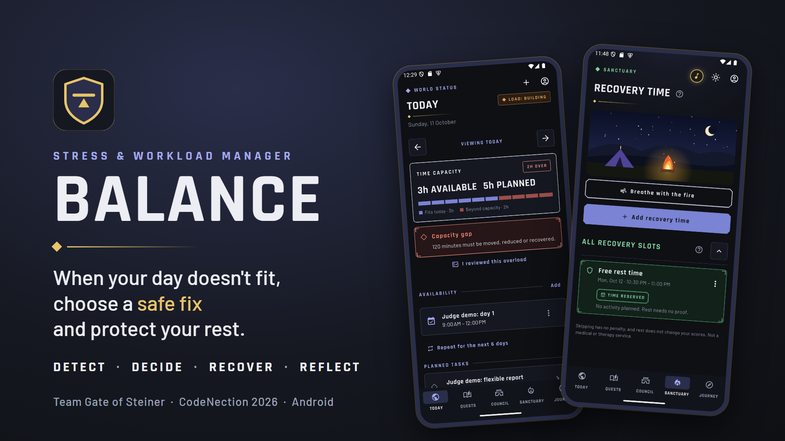

<p align="center"></p>

# Balance — workload planning for overloaded students

**Team Gate of Steiner:** Lim Ze Heng, Tan Yi Ming, Chong Zhi Xuan, Matthew Thien Yung En
**Problem statement:** Stress & Workload Manager

| | |
| --- | --- |
| 📱 **Download (Android APK)** | [Latest release](https://github.com/aronlim47-maker/balance/releases/latest) — `app-release.apk`, Android 8.0 or later |
| 📖 **User guide for judges** | [docs/USER_GUIDE.md](docs/USER_GUIDE.md) · [PDF](docs/Balance_User_Guide.pdf) · [Word](docs/Balance_User_Guide.docx) |
| 🔑 **Judge account** | Supplied in our submission form (never stored in this repository) |
| 📝 Release notes | [docs/RELEASE_NOTES.md](docs/RELEASE_NOTES.md) |
| 🎬 Preliminary pitch video | [YouTube](https://www.youtube.com/watch?v=DV6PFbYdbk8) |
| 🖼️ Preliminary slides | [Google Slides](https://docs.google.com/presentation/d/1_ctq2F96NrVD1dD9PSV1PLKwfyI83E4G-brSaejZjLE/edit?usp=sharing) |

<p align="center"></p>

## What Balance does

University students juggle assignments, exams, part-time shifts, family duties and
group work in the same few hours. When the plan no longer fits, they need to know
three things: **what must stay protected, what can move, and what each change will
cost.** Balance answers those questions in one flow:

**Detect → Decide → Recover → Reflect**

| Practical feature | RPG label | What it does |
| --- | --- | --- |
| Workload Overview | World Status | Planned vs available minutes first, then five load dimensions (Mental, Time, Physical, Social, Errands) with their change since yesterday and a 7-day trend. Missing data shows **Unknown**, never zero. Availability can be copied from the previous day or repeated for a week. |
| Tasks and Protected Commitments | Quest Board | Tasks with category, duration, deadline, flexibility and protection; tap a task for its details. Protected work is never moved to make a plan look feasible. |
| Plan Comparison | War Council | Compares safe moves (whole or part of flexible tasks) and shows what changes, what stays protected and the cost on other days. Nothing changes until you **Confirm**; every confirmed plan can be **Undone** from Plan history. When no safe move exists it explains why and names how much free time on which day would unlock one. |
| Recovery Time | Sanctuary | A rest camp: a campfire scene whose sky follows the clock, a soft crackle while music is on, and an optional one-minute "Breathe with the fire" exercise. Protects genuinely freed time for optional rest and suggests free windows to choose from. Skipping has no penalty and rest is never scored. |
| Weekly Reflection | Journey | Private weekly summary, optional reflection and an RPG achievement wall of seven sustainable-planning badges, celebrated once when earned. No streaks, rankings or rewards for overwork. |
| Overload Alert | Calamity Alert | Optional notification the evening before a day with more planned work than available time. Off by default. |

Also: a five-step animated beginner guide (Profile → Beginner guide), sound (effects and relaxing music on by default,
one-tap music button on every page; all audio original), dark and parchment light looks,
short one-shot animations on the core journey (capacity bar, workload bars, plan
confirmed and undone), a gold guild-crest app icon, foldable page sections with ? help,
and accessibility checks on every main page.

Balance is a planning aid. Its scores describe recorded planning data; they are not a
medical, diagnostic or mental-health assessment.

## Try it in five minutes

1. Install the APK from the [latest release](https://github.com/aronlim47-maker/balance/releases/latest)
   on an Android phone (allow installing from this source when asked).
2. Sign in with the judge account supplied in our submission form. Credentials are
   never stored in this repository.
3. **Today:** the sample day (1 November 2026) has 300 planned minutes but only 180
   available, a 120-minute overload, and five World Status bars.
4. **Council:** compare the options, **Confirm** one, check Today, then **Undo** it from
   Plan history.
5. **Sanctuary:** protect 30 minutes from a suggested free window. **Journey:** see the
   weekly summary and the achievement wall.

Step-by-step instructions with screenshots are in the [user guide](docs/USER_GUIDE.md).

## Scope and known limitations

- Android 8.0 or later is the supported platform. A web build compiles but has not
  passed browser acceptance; iOS has not been tested on a device.
- Times follow the phone's time zone; set it to Malaysia time to match the sample data.
- **Team Coordination** stays Locked: shared tasks with real agreement workflows are a
  future version.
- Every task needs a deadline; a "No deadline" option is a design proposal only.
- The app is currently English-only. Bahasa Melayu and Chinese, selectable in Profile,
  are planned.
- Email verification and password-reset links must be opened on the same phone that
  requested them.

## Built with

Flutter and Dart (Android first) · Supabase Auth, PostgreSQL, Row Level Security and
transactional RPCs · Provider + go_router. The [Architecture](#architecture) and
[Testing and coverage](#testing-and-coverage) sections below give details: 450
automated tests pass and critical code has 93.4% line coverage, enforced by CI.

**Monitoring.** An hourly GitHub Actions job
([Production health check](.github/workflows/health.yml)) verifies that Supabase Auth
responds and that the published APK download link works; a failed run emails the
maintainer. Crash reporting uses Sentry (errors only; no screenshots, IP address or user
email).

---

# Developer documentation

Balance is a Flutter workload-planning app with personal tasks, five-dimension World
Status, Supabase authentication, server-checked Council Confirm/Undo, Sanctuary, a private
Journey and plan/reflection history. This section is for developers who want to run their
own copy; judges only need the [user guide](docs/USER_GUIDE.md).

## Supabase setup

1. Create a Supabase project.
2. Open the Supabase SQL Editor and run each unapplied migration once, in filename order: `202609240001_initial_schema.sql`, `202609250001_war_council_integrity.sql`, `202609270001_world_status_achievements.sql`, `202609270002_verified_progress.sql`, `202610010001_planning_consistency.sql`, `202610010002_atomic_social_event.sql`, `202610020001_recovery_history.sql`, `202610020002_planning_adapter_compatibility.sql`, `202610030001_active_planning_occupancy.sql`, `202610030002_retry_safe_social_event.sql`, `202610040001_plan_review_version.sql`, `202610040002_restore_progress_helpers.sql`, then `202610080001_require_task_category.sql`. The last migration rejects new tasks without a category (every released app version sends one) and keeps older rows without a category, which the app shows as *Uncategorized · Needs Review*. For an existing database, apply only migrations not already run. Each migration depends on those before it. Social-event creation requires the atomic-social-event migration; do not fall back to separate writes. Recovery history requires `202610020001_recovery_history.sql` and is recorded only when today's World Status is captured; past days are not backfilled.
3. Copy `.env.example` to `.env`.
4. Put the project URL and publishable key in `.env`. Never use the `service_role` key in the Flutter application.
   Optional: set `SENTRY_DSN` to the Sentry project DSN to enable crash reporting. When it is
   empty, Sentry is not initialised. Reports contain errors and stack traces only: no
   performance tracing, screenshots, IP address or user email.
5. Run the app with:

```powershell
flutter run --dart-define-from-file=.env
```

In Android Studio, the local `main.dart` Flutter run configuration includes `--dart-define-from-file=.env` in **Additional run args**. Select that configuration and the Android emulator, stop any old local-preview instance, then press Run again. If Android Studio recreates the configuration, add the same argument under **Run > Edit Configurations > Flutter > Additional run args**. A hot reload cannot change compile-time Dart defines; start a new run.

For an Android APK, build it with the same compile-time configuration:

```powershell
flutter build apk --release --dart-define-from-file=.env
```

The permanent Android application ID is `com.gateofsteiner.balance`. Release signing reads `android/key.properties` (copy `android/key.properties.example`); the file and the `.jks` keystore are git-ignored and must stay out of Git. Without `key.properties` the release build falls back to the debug key and prints a warning: such an APK is for internal testing only and must not be distributed. Because the ID changed from `com.example.balance`, uninstall any earlier test build before installing; verify a fresh install on a real device before publishing.

Install that newly built APK on the device. A debug app started without the `--dart-define-from-file=.env` argument runs in local preview mode even when `.env` exists on the computer. A release app without these values stops with a configuration notice instead of silently entering preview. The app now displays a persistent local-preview banner and the Profile page shows the connection mode. Tasks made in local preview are only in memory; they are not sent to Supabase and cannot be automatically recovered or synced after switching modes. Re-create those tasks after launching the configured build.

The first migration creates the seven MVP tables, automatically creates a profile after signup, and enables Row Level Security. The second migration adds the War Council validation and atomic confirm/undo checks. Until it is applied, the app shows an upgrade notice and disables plan confirmation.

Before testing day-by-day planning, open Profile and set the signed-in user's planning time zone to match the device (for example, `Asia/Kuala_Lumpur` in Malaysia). New profiles default to `UTC`; a mismatch can make the app and database assign work near midnight to different days. The Profile page saves this setting to `profiles.time_zone`.

War Council labels plans as Feasible, Needs Review, Needs Agreement or No Feasible Plan. It compares its capacity calculation with the database before enabling confirmation; a mismatch is shown as Needs Review. Fixed and protected tasks and protected recovery are listed separately. Agreement-dependent suggestions are visible but cannot be confirmed until the task is updated after agreement.

To test War Council after upgrading, add three hours of availability on one future day and two hours on the following day. Create one flexible, unprotected task scheduled for the full three hours on the first day, with a deadline after the second day. Create another unscheduled two-hour task due on the first day. War Council should propose moving two hours of the scheduled task to the second day. Confirm it, check both days in Today, then undo it on the plan-updated screen or from Plan history. The first day's original overload should return after undo. Avoid changing the tasks or availability between confirm and undo, because the undo safety check may correctly reject restoration if a new conflict was introduced.

Without Supabase values, debug builds stay in local development mode so UI work and widget tests can continue; release builds stop at the setup notice.

User-facing failures are translated into concise English guidance for common authentication, connectivity, scheduling, permission and database cases. Unknown technical errors are not displayed verbatim; the app asks the user to retry instead.

## Verification

### Account recovery on mobile

In Supabase Authentication URL Configuration, add exactly
`com.balance.app://auth-callback/` to Redirect URLs. Keep the standard confirmation
and recovery email templates pointing to Supabase's generated confirmation link.
The Android/iOS handlers pass the callback to Supabase for verification; a route
name alone cannot authorize a password update. Install a freshly rebuilt app after
changing native link configuration; hot reload cannot add an Android intent filter.

From Sign in, choose **Forgot password or need verification?**. Enter the account
email, then choose a reset link or resend verification. Open the new email link on
the same device and installation that requested it (PKCE verification uses local
state). A verified recovery link opens Choose a new password. Set matching
passwords with at least 8 characters, or Cancel and sign out. Invalid/expired
links show safe guidance; request a fresh link. Rate limits and email delivery
remain governed by the project's Auth configuration. Messages intentionally do
not confirm whether an email belongs to an account.

Acceptance on a real device: test signup verification, verification resend,
password recovery with the app open and closed, expired/used links, cancellation,
then sign out and confirm the old password fails and the new password works.
These email delivery/native-link cases are not proven by widget tests. iOS link
configuration is prepared but requires verification on macOS and an iPhone.

After migration 002, run `supabase/manual/20260927_verified_progress_checks.sql` in the SQL Editor. Its read-only checks verify function availability, grants and RLS configuration. Then sign in through the app with two distinct accounts and confirm each account sees only its own tasks, recovery slots, snapshots and awards. The SQL Editor's privileged role cannot prove user isolation.

With one account, record a protected recovery slot in Sanctuary; check its achievement in Journey. Create a protected work shift task; check Protected Limit. Confirm a feasible Council plan and undo it; Safe Trade-off must stay unlocked. Save a Journey reflection; Reflection should unlock. Early Review requires an overloaded current day and a task whose local deadline is on a later day. Team Coordination remains locked until the V2 shared-task workflow supplies real evidence. Retry the same actions or use a second device: `user_achievements` must keep one award per key. Today and Profile must show the same five-dimension score after refresh. Journey shows only actually captured days; missing history says “No record”.

`capture_world_status` records today's server-derived snapshot when Today loads.
It does not backfill historic days. Open the app on multiple days to accumulate
a real trend. The configured profile time zone should match the device for day
boundaries. For the production deployment state, see *Production database status* below.

```powershell
flutter analyze
flutter test
```

## Production database status

The production Supabase project (`zuilqjrwpyilsbaitmwo`) has every migration above applied,
through `202610080001_require_task_category.sql`. Three transaction-and-rollback scripts in
`supabase/tests` were run against it and passed, with all test writes rolled back:

- `verified_progress_runtime.sql`: today's snapshot, verified reflection evidence, repeat
  evaluation without duplicate awards, private helpers.
- `active_planning_and_retry.sql`: stale or missing task versions, Confirm/Undo, active
  occupancy and retry-safe social saves.
- `world_status_achievements.sql`: Row Level Security, grants, trusted writes and
  cross-owner checks.

Physical-phone results (Samsung Galaxy A55 5G, 22 scripted checks) and every release APK
with its SHA-256 are recorded in the [evidence pack](docs/BUILDING_EVIDENCE_PACK.md).

## Architecture

Balance is one Flutter/Dart codebase (Android first) with Supabase for sign-in and storage.
Dependencies point one way:

```text
Flutter screens (lib/features/*)  ->  view-models (ChangeNotifier + Provider)
        ->  domain rules (lib/domain: models, enums, usecases; no Flutter, no I/O)
        ->  repository interfaces (lib/data/repositories)  ->  services/mappers  ->  Supabase
```

- `lib/domain/usecases` holds the pure rules: `DailyCapacity`, `generateTradeOffs`,
  `validatePlan`, the five-dimension `WorldStatusCalculator` (formula `world_status_v1`),
  `WorldTrendCalculator` (rolling 7-day load and moving average, Unknown ignored) and
  `AchievementEvaluator` (reference eligibility rules for the seven achievements).
- Unknown is never zero: missing data is `null` / `DataStatus.unknown`; only a recorded zero is `0`.
- Awards and World Status snapshots are written only by trusted database functions
  (`supabase/migrations`). `AchievementEvaluator` documents and tests the same rules in Dart
  but never grants anything; the client cannot send an "isEligible" flag.

## Testing and coverage

```powershell
flutter analyze
flutter test                                  # all Dart tests
flutter test test/domain                      # pure domain rules only
flutter test --plain-name WS05                # one acceptance case
flutter test --coverage                       # writes coverage/lcov.info
python tools/check_coverage.py --min 70       # critical code: lib/domain + *_view_model.dart
```

`tools/check_coverage.py` prints per-file line coverage for the critical code and exits 1 when
the combined figure is below `--min`. CI enforces the 70% minimum; the 13 October 2026 local
run measured 93.4% (2607/2792 lines) with 450 tests passing.
The WS01-WS14 and achievement test map is `docs/WS_AND_ACHIEVEMENT_TEST_MAP.md`.
`test/domain/full_scenario_test.dart` is the domain-level full-journey regression
(300 minutes proposed for a 180-minute evening). SQL scripts in `supabase/tests` need a
disposable Supabase database and are not run by `flutter test`.

## Judge guide and judge accounts

Judges follow [docs/USER_GUIDE.md](docs/USER_GUIDE.md) (also as PDF and Word in `docs/`).
What changed in this build: [docs/RELEASE_NOTES.md](docs/RELEASE_NOTES.md).

Judge accounts are prepared by the team, never by the repository: create a fresh Auth
account, set its profile time zone to `Asia/Kuala_Lumpur` **before** seeding, then run
`supabase/manual/20261008_judge_demo.sql` with `demo_date` 2026-11-01. Judge accounts are
read-only during judging, so the sample day stays the same for every judge. Credentials are
shared out of band and never committed.
